八月初去了一趟北京，參加阿帕奇軟件基金會亞洲大會 **Community Over Code Asia 2026**（8/7–8/9）。這次在 Streaming 分會場講了 Kafka Streams 4.2.0 內建的 Dead Letter Queue，也聽了不少場、吃了不少東西。趁記憶還沒散，把這幾天整理成一篇。

<!-- truncate -->

## 為什麼會去

<!-- TODO: 補上投稿的契機（例如 KIP-1034 研究完想分享、誰推了你一把、CFP 什麼時候投的、收到錄取的心情） -->

今年上半年把 [KIP-1034 的內建 DLQ](/blog/kafka-kip-1034-dlq) 從頭到尾研究了一遍，也寫了範例程式。研究完覺得這個題目很適合拿出來講：幾乎每個用 Kafka Streams 的團隊都自己手刻過 DLQ，而 4.2.0 終於把它做進框架、還顧到 transaction 的語意。於是就投了 CoC Asia 的 Streaming track。

## Streaming 分會場

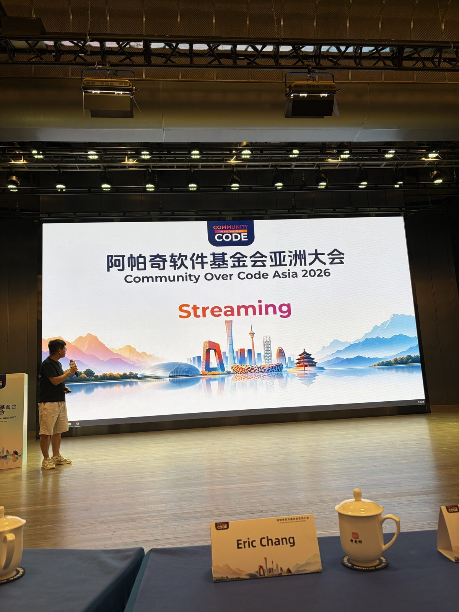

Streaming 分會場的開場。桌上擺了名牌和印著會場 logo 的茶杯，坐在講者席看台上的感覺跟平常當聽眾很不一樣。

### 我的場次：Kafka Streams 4.2.0 Dead Letter Queue

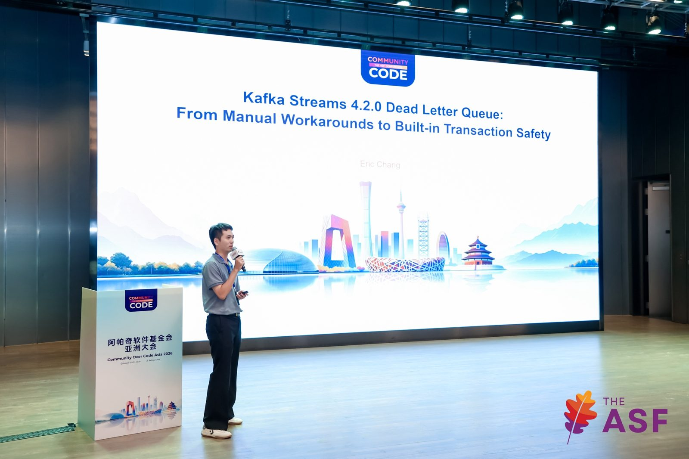

題目是 **Kafka Streams 4.2.0 Dead Letter Queue: From Manual Workarounds to Built-in Transaction Safety**，內容大致分三段：

<!-- TODO: 以下段落是依 KIP-1034 那篇文章推測的演講架構，請對照實際投影片修正 -->

1. **過去怎麼做**：在 `DeserializationExceptionHandler`／`ProductionExceptionHandler` 或 processor 裡自己 `try-catch`、自己開一個 producer 把壞資料丟到另一個 topic。問題在於這個 producer 不在 Streams 的 transaction 裡，開了 EOS 也保證不了「壞資料只進 DLQ 一次」。
2. **KIP-1034 帶來什麼**：exception handler 可以直接回傳要送進 DLQ 的 record，由 Streams 自己的 producer 送出，跟正常輸出走同一個 transaction。
3. **怎麼遷移**：設定 `errors.dead.letter.queue.topic.name`、header 裡帶了哪些錯誤資訊、自訂 handler 時要注意的地方。

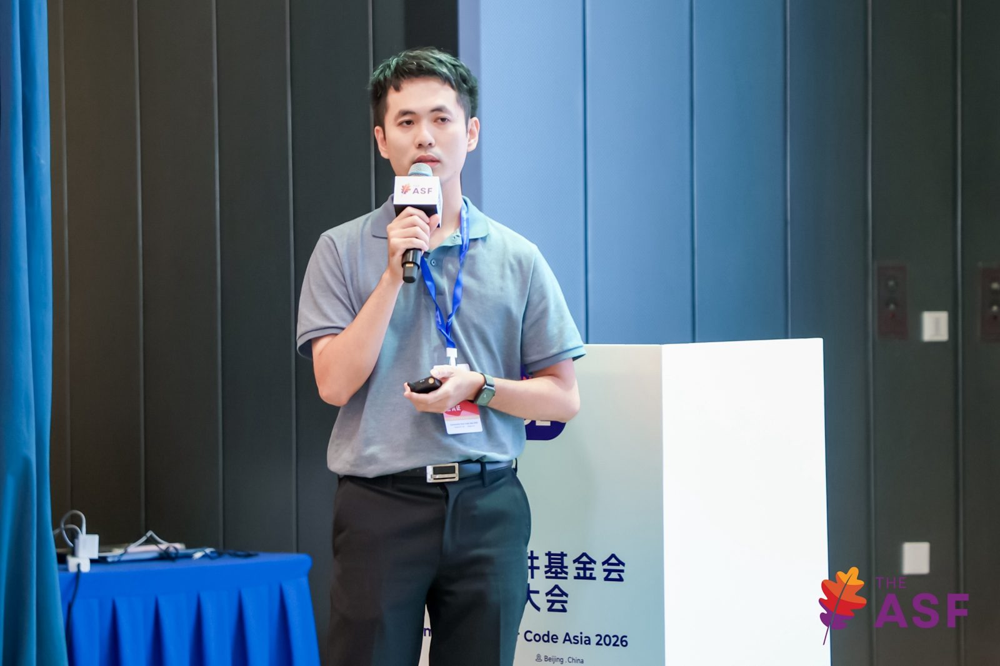

<!-- TODO: 補上台上的感受與 Q&A —— 緊張嗎？聽眾問了什麼問題？有沒有哪個問題讓你回去又翻了 source code？ -->

完整的技術內容和可以跑的範例都在之前那篇 [Kafka 4.2.0 KIP-1034：內建 DLQ，終結手動錯誤處理](/blog/kafka-kip-1034-dlq)，有興趣可以直接看那篇。

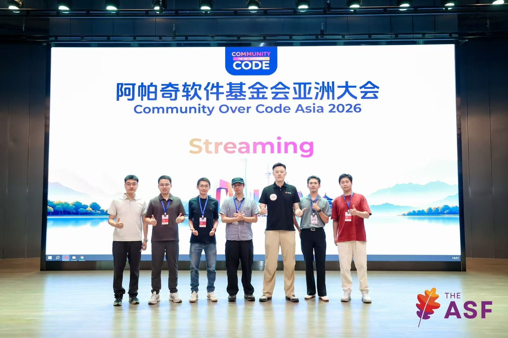

分會場結束後，Streaming track 的講者一起上台合照。

### 其他印象深刻的場次

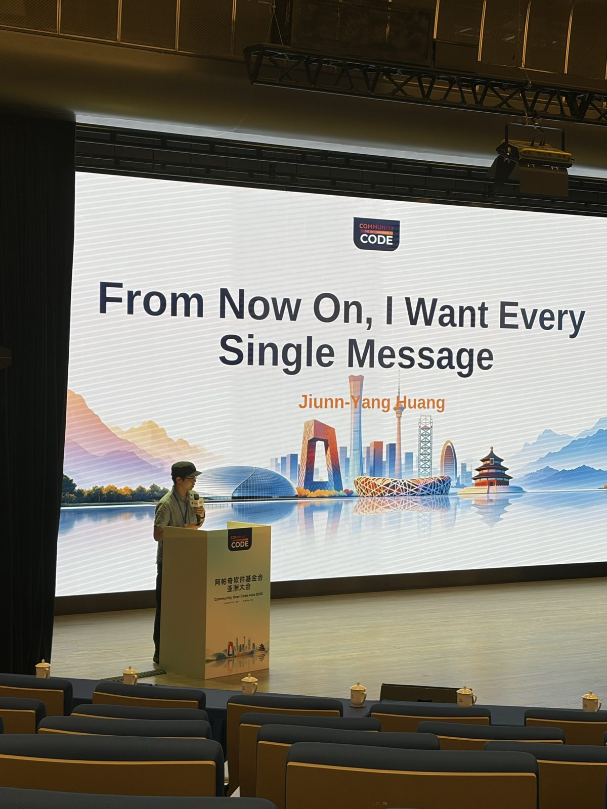

**Jiunn-Yang Huang — From Now On, I Want Every Single Message**

<!-- TODO: 補上這場的重點與你的心得 -->

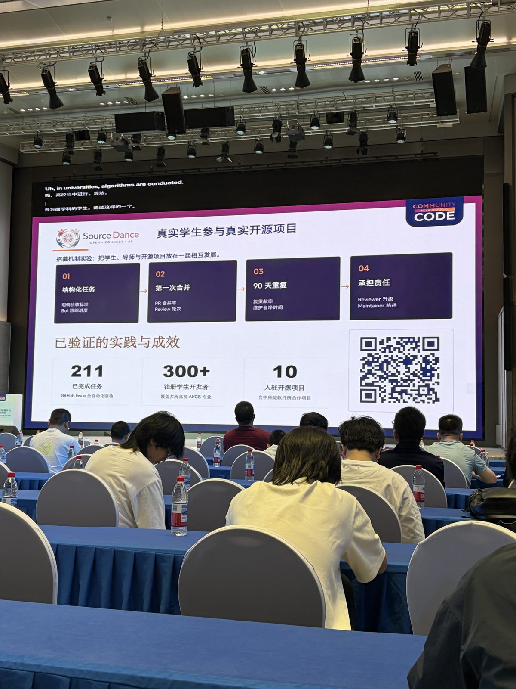

**Source Dance：真實學生參與真實開源項目**

這場在講怎麼把學生、導師和開源專案放在一起。他們把流程拆成四步：

1. **結構化任務**：明確的驗收標準，用 bot 追蹤進度
2. **第一次合併**：看 PR 合併率、review 輪次
3. **90 天重複**：看復貢獻率、維護者花的淨時間
4. **承擔責任**：往 reviewer、maintainer 的路徑走

台上給的數字是 211 個已完成任務（GitHub Issue 全自動驅動）、300+ 名註冊學生開發者、10 個入駐開源專案。我覺得有意思的是他們量的不是「來了多少人」，而是「第一次合併之後，90 天內還有沒有回來」——這才是開源社群真正缺的東西。會場還有即時的中英字幕，對聽不懂中文的國外講者很友善。

<!-- TODO: 補上你對這場的想法，或跟台灣開源社群的比較 -->

## 吃在北京

會議很充實，但老實說吃的部分也很充實。

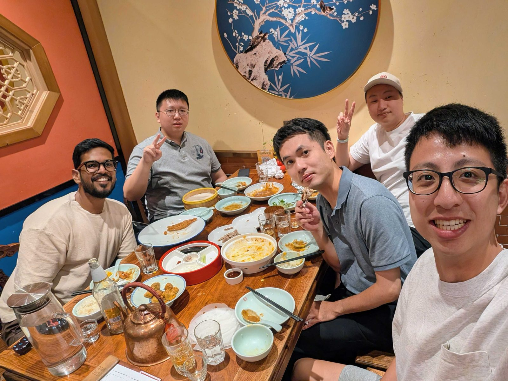

<!-- TODO: 補上這頓晚餐是跟誰（社群朋友／其他講者）、怎麼約的 -->

這家的碗盤上都印著「小吊梨湯」，桌上那壺銅壺就是招牌的吊梨湯。

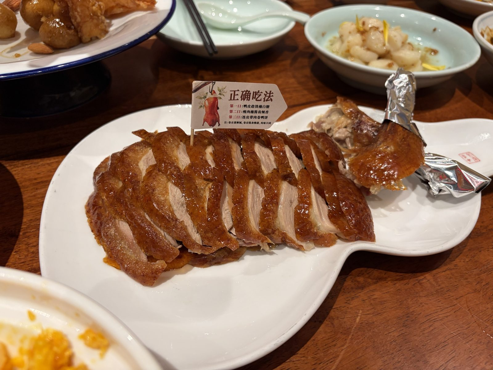

烤鴨一定要點。盤子上插著一支「正確吃法」小旗子：

- 第一口：鴨皮趁燙蘸白糖
- 第二口：瘦肉蘸醬，齒頰留香
- 第三口：連皮帶肉卷鴨餅

旗子底下還有一行小字：卷京蔥解膩，卷京糕條酸甜，風味不同。照著吃了一輪，蘸白糖那口真的出乎意料地好吃。

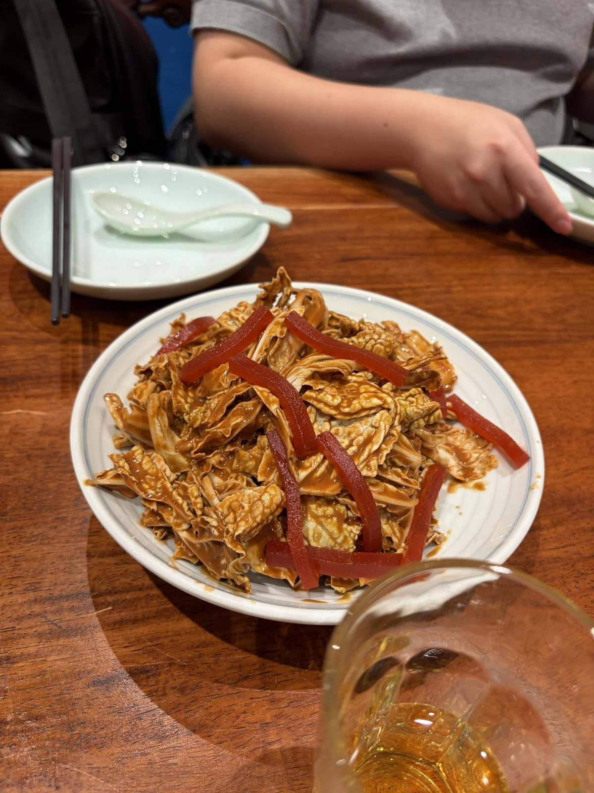

麻醬拌白菜，上面鋪著山楂糕條，酸甜配麻醬很開胃。

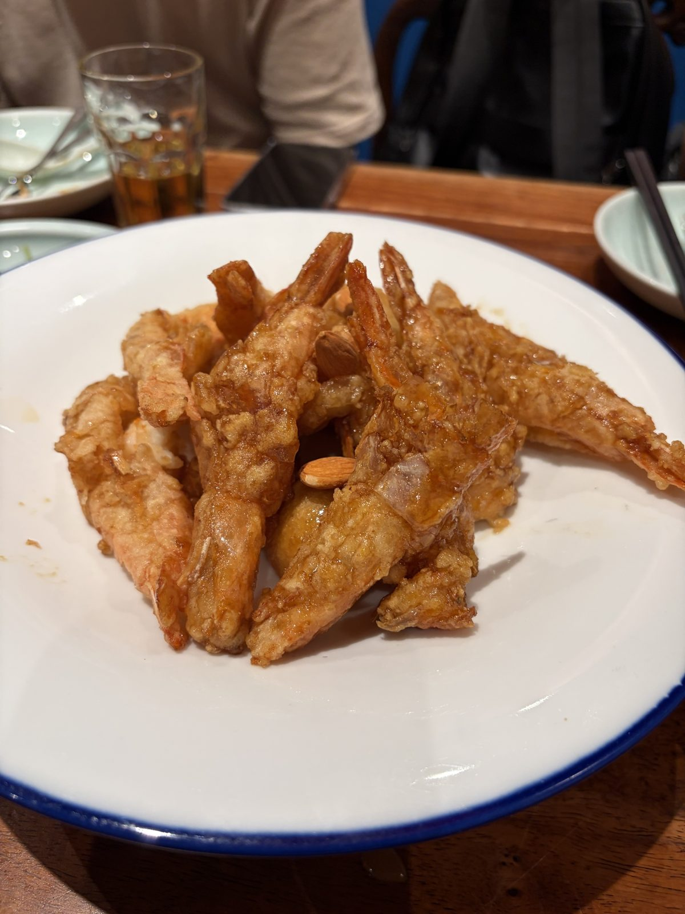

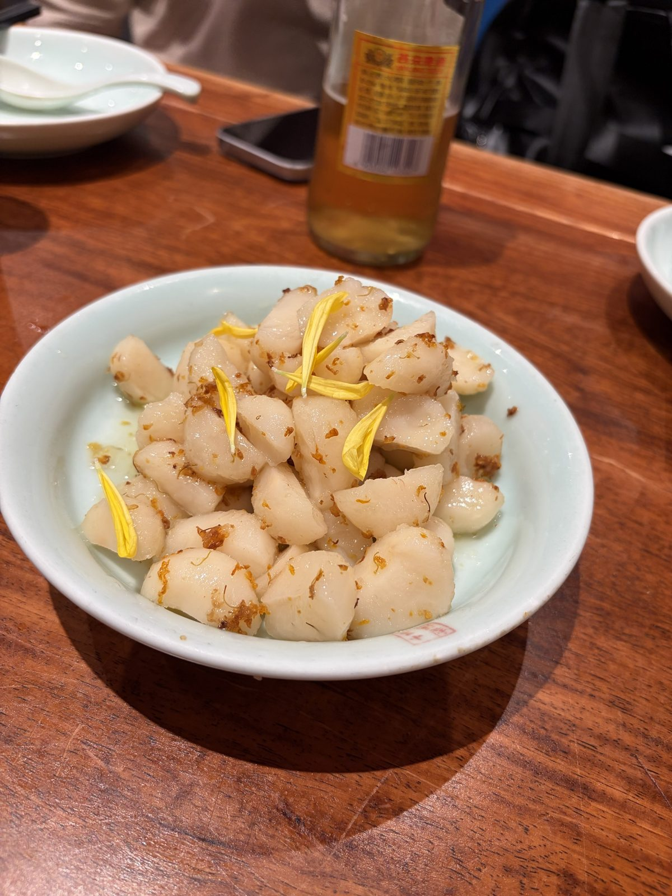

<!-- TODO: 確認這兩道菜的名稱與口味 -->

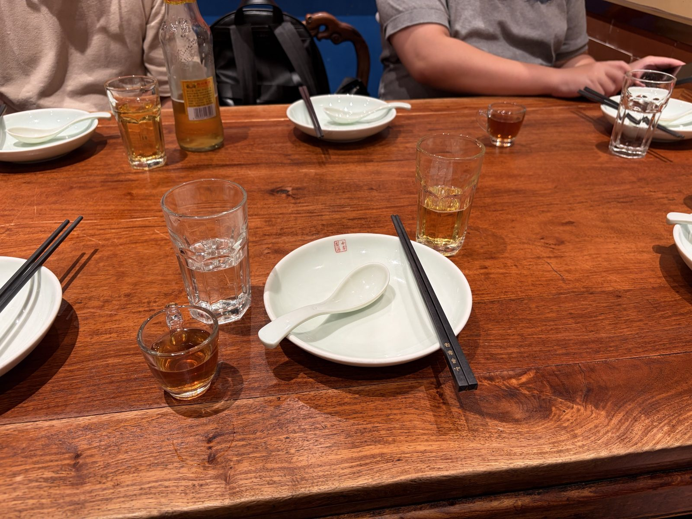

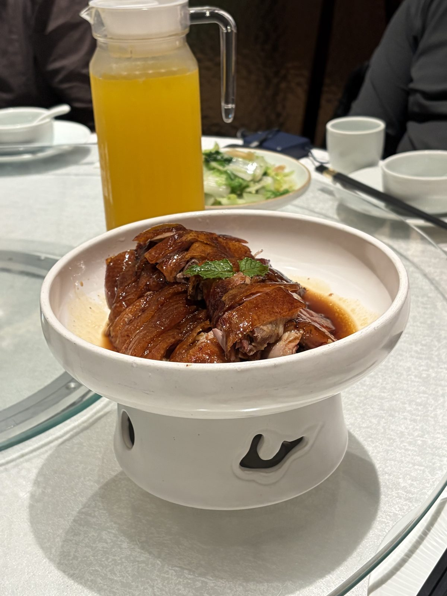

<!-- TODO: 這是哪一頓（講者晚宴？）、在哪裡 -->

## 一些北京日常

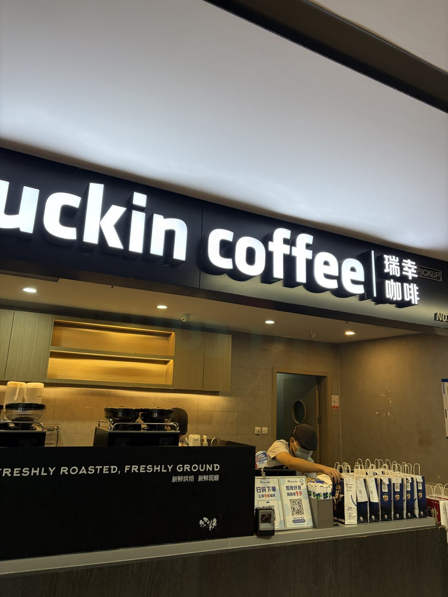

瑞幸咖啡幾乎到處都是，掃碼下單、到櫃台拿，櫃台上一整排等人取的紙袋。

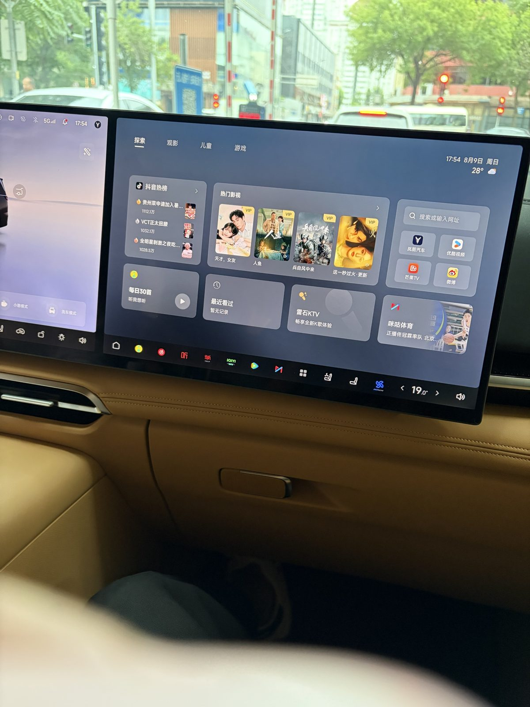

<!-- TODO: 確認是叫車還是朋友的車 -->
叫車坐到的電動車，副駕前面整片都是螢幕，抖音熱榜、影音平台、KTV 全都有。坐在車上很直接地感受到這邊的車機生態走得多快。

## 心得

<!-- TODO: 這段是全文的重點，建議用你自己的話寫。下面是可以參考的方向，不要的就刪掉 -->

- **第一次在 ASF 官方大會上講自己研究的東西**：從讀 KIP、讀 source code、寫範例、寫文章，到站上台講給別人聽，這是一條完整的路。準備演講的過程逼自己把很多原本「大概懂」的地方弄到真的懂。
- **Community Over Code 這個名字**：這幾天最深的感受是，大會在講的不只是技術，而是人怎麼進到社群、怎麼留下來。Source Dance 那場的「90 天重複」就是在講這件事。
- **見到網路上的人**：平常只在 GitHub、mailing list、Slack 上互動的人，見面聊個天，之後 review PR 的感覺就不一樣了。
- **下一步**：<!-- TODO: 例如接下來想貢獻 Kafka 的哪一塊、明年還想不想投稿 -->

謝謝主辦單位和志工，也謝謝這幾天一起吃飯、聊天的朋友們。明年見！
